

  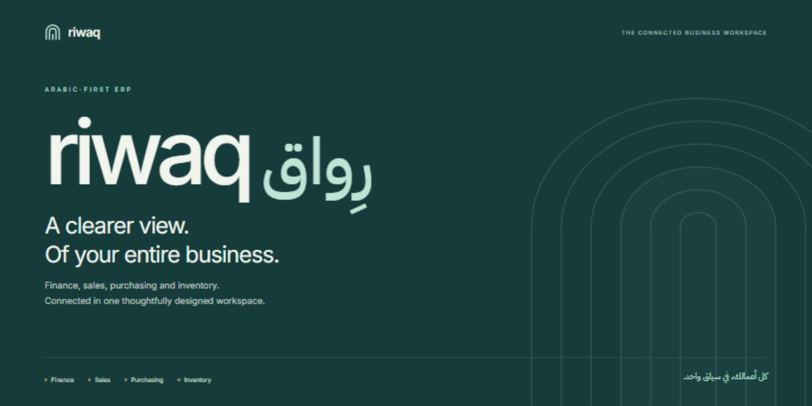

<h1 align="center">RIWAQ · رِواق</h1>

<strong>Finance, sales, purchasing and inventory. One connected workspace.</strong>

An Arabic-first ERP with an equally considered English experience. Built around real business workflows, precise accounting and a clear, cohesive interface.

  
  
  
  
  

<a href="#a-look-inside">Product tour</a> · <a href="#capabilities">Capabilities</a>

<strong>كل أعمالك، في سياق واحد.</strong> رِواق يجمع المحاسبة والمبيعات والمشتريات والمخزون في مساحة واحدة، بواجهة عربية أصلًا، وصلاحيات دقيقة، ومسارات عمل مترابطة.

---

## A look inside

### Your business, in context

A quiet workspace with clear organization context, grouped navigation and direct access to everyday work. The dashboard uses live organization data; it does not substitute decorative charts for real information.

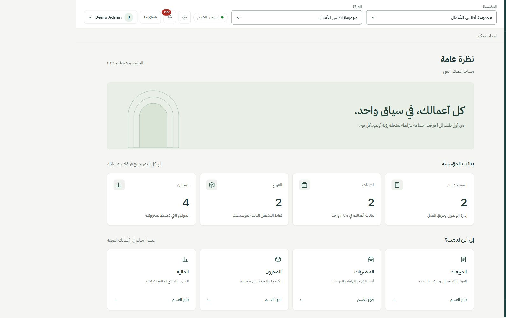

<table>
  <tr>
    <td width="50%"><strong>Sales &amp; collections</strong> Follow invoices, outstanding amounts and payment status.  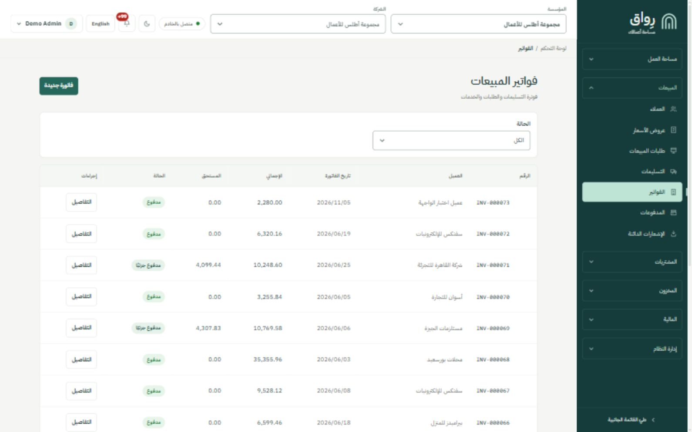</td>
    <td width="50%"><strong>Inventory visibility</strong> Track on-hand, reserved and available stock by warehouse.  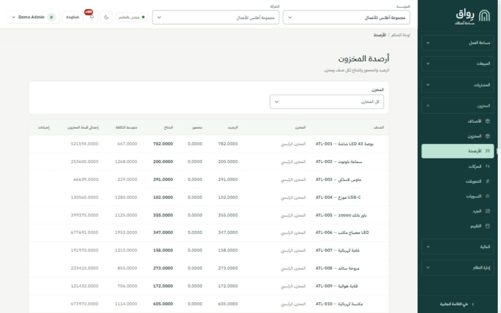</td>
  </tr>
  <tr>
    <td width="50%"><strong>Connected purchasing</strong> Manage supplier orders and follow their operational status.  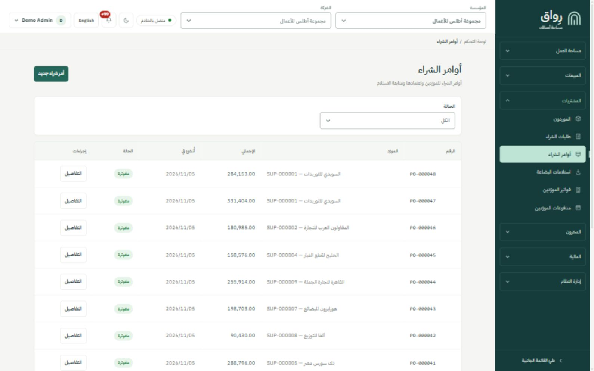</td>
    <td width="50%"><strong>Financial clarity</strong> Read account movements and period-based financial results.  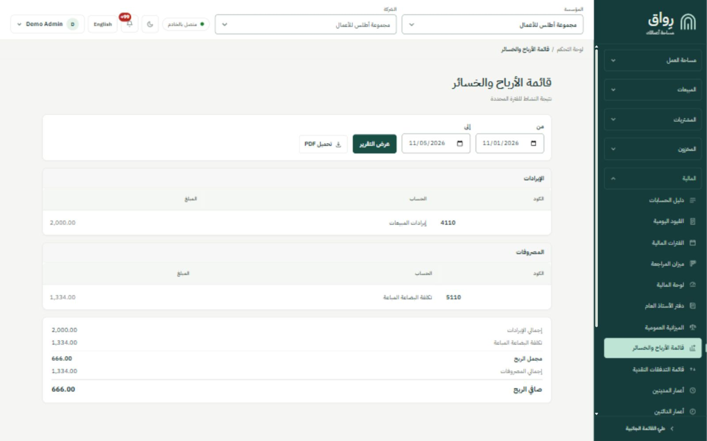</td>
  </tr>
</table>

### Two languages. One consistent experience.

Native right-to-left layouts, English left-to-right navigation, light and dark themes, and responsive forms and tables. Searchable choices support keyboard selection and keep full business labels readable.

<table>
  <tr>
    <td width="50%">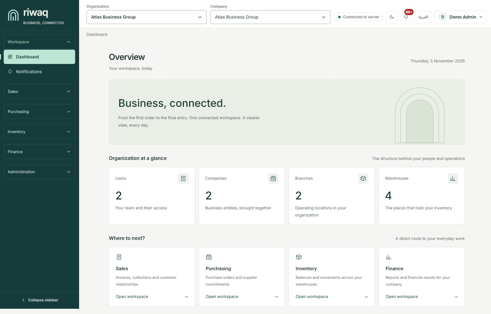
English · Light
</td>
    <td width="50%">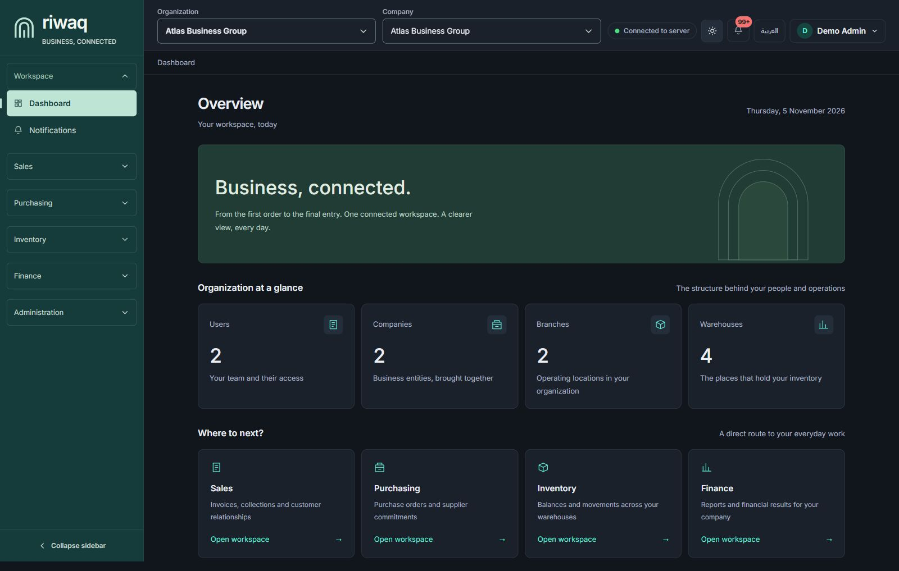
English · Dark
</td>
  </tr>
</table>

<strong>More views: sign-in, catalog, invoice detail and mobile</strong>

 

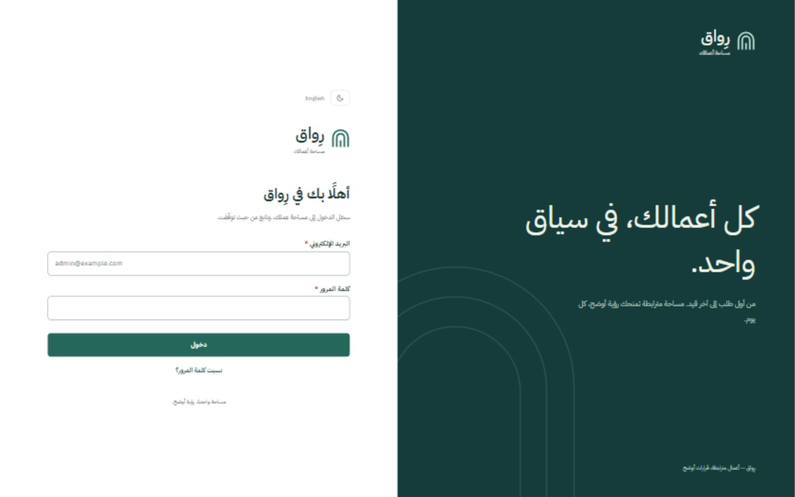

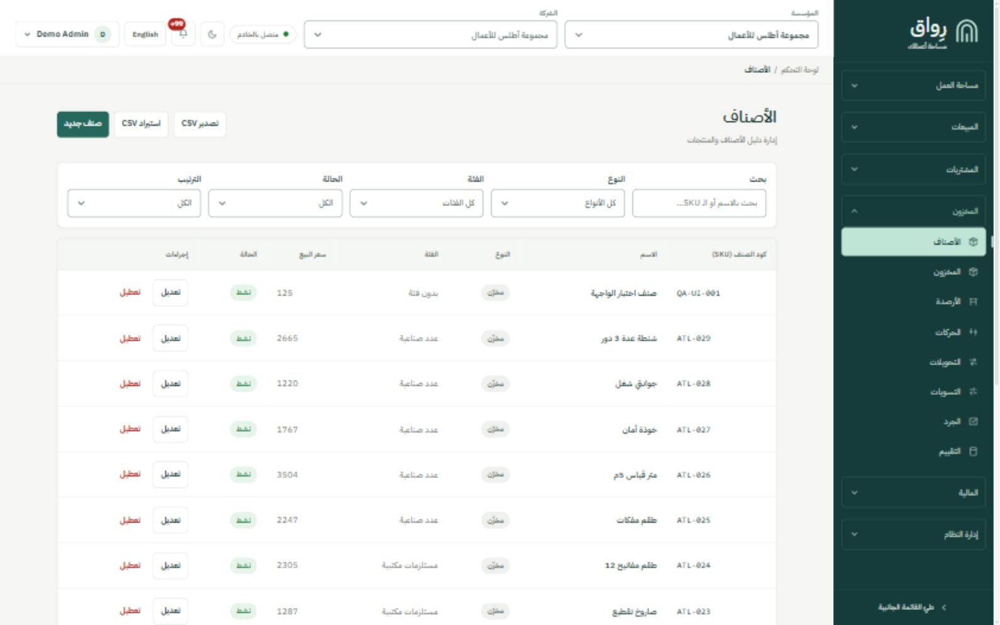

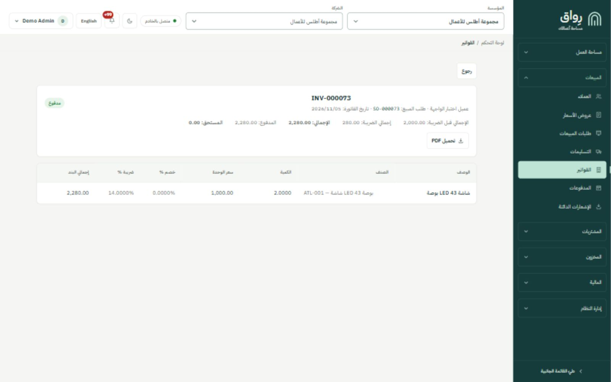

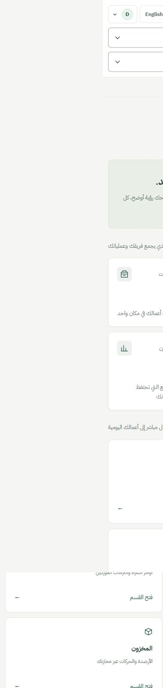

## Capabilities

- Finance and double-entry accounting.
- Sales, purchasing and document workflows.
- Product catalog and warehouse inventory.
- Arabic RTL and English LTR interfaces.
- Role-based access and organization/company context.
- Responsive layouts with light and dark themes.

Screenshots show fictional demonstration data. This project is under active development.
